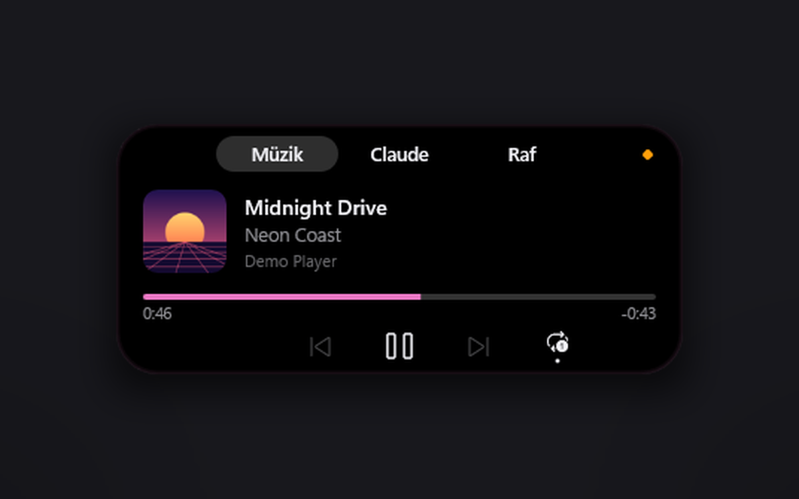
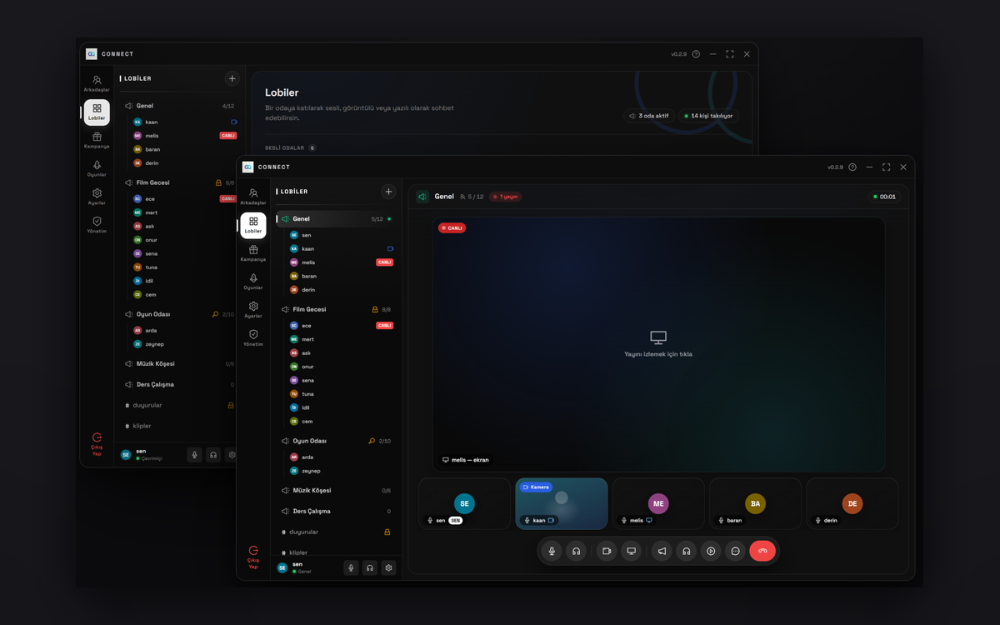
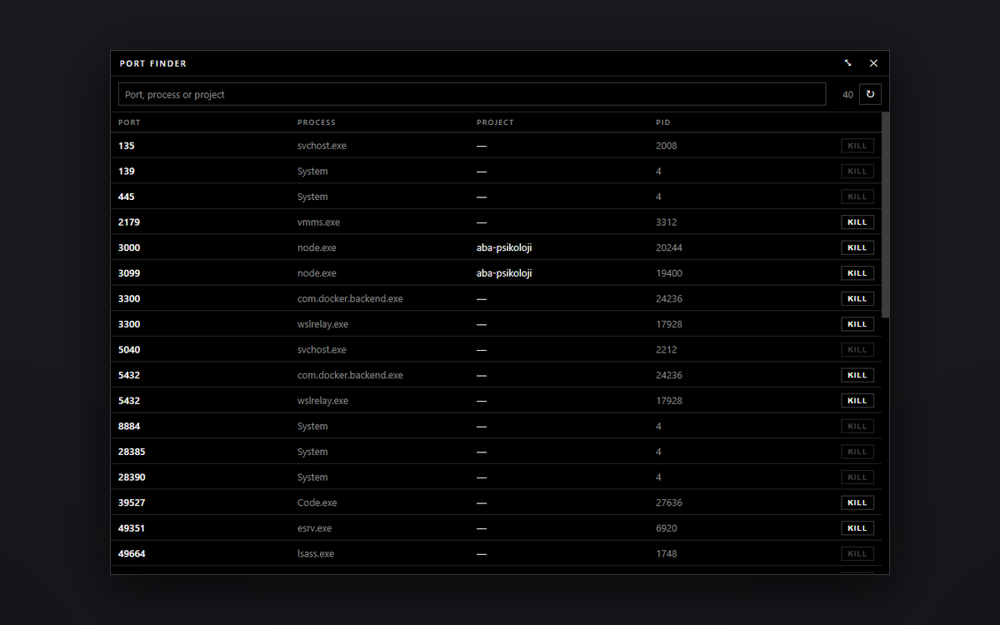
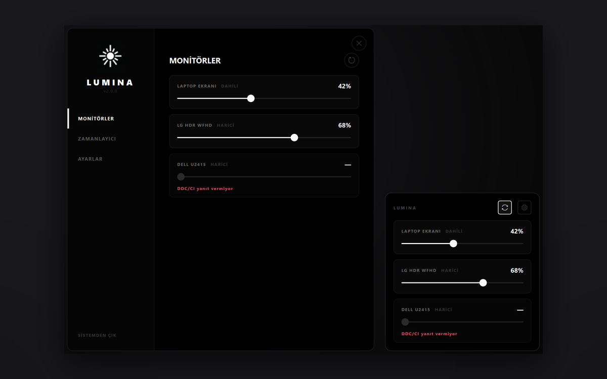

### Hi, I'm nightdevx

Full-stack developer from Kayseri, Türkiye. I build web and mobile apps for a living, and small Windows tools whenever something on my own desk annoys me enough.

Mostly TypeScript and Go. Rust or Python when a tool has to talk to the OS directly.

<table>
  <tr>
    <td width="50%" valign="top">
      
      <h3><a href="https://github.com/nightdevx/dynamic-island-windows">Dynamic Island for Windows</a></h3>
      Now playing, Claude Code sessions and limits, volume, mic/camera state and headset battery in a small pill at the top of the screen.
       Rust · ~10 MB RAM
    </td>
    <td width="50%" valign="top">
      
      <h3><a href="https://github.com/nightdevx/connect-desktop">Connect</a></h3>
      Voice, video and game streaming for friend groups: lobbies, screen share, music and a friends list.
       Electron · React · Go · LiveKit (WebRTC)
    </td>
  </tr>
  <tr>
    <td width="50%" valign="top">
      
      <h3><a href="https://github.com/nightdevx/port-finder">Port Finder</a></h3>
      What is holding port 3000? Lists every listening port with the project behind it, and kills it in one click.
       Electron · React · TypeScript
    </td>
    <td width="50%" valign="top">
      
      <h3><a href="https://github.com/nightdevx/Lumina">Lumina</a></h3>
      One tray slider for every screen's brightness: the laptop panel and DDC/CI external monitors.
       Python · PySide6 · dxva2 + WMI
    </td>
  </tr>
</table>

### Toolbox

Mobile apps with React Native and Expo.

### Right now

Making Connect's game streams use fewer bits at the same quality.

### Contact

[iletisim@nightdijital.com](mailto:iletisim@nightdijital.com) · [nightdijital.com](https://nightdijital.com)

Türkçe yazabilirsin, Türkçe cevap veririm.
